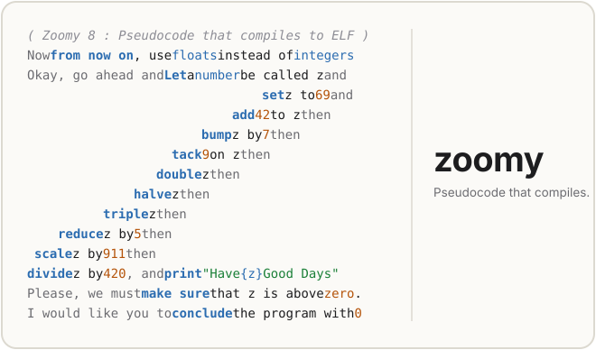

<p align="center">
  
</p>

<details>
<summary>The Logo above is real Zoomy code — click to copy and run it.</summary>

```
(  Zoomy 8 : Pseudocode that compiles to ELF  )
Now from now on, use floats instead of integers
Okay, go ahead and Let a number be called z and
                               set z to 69 and
                           add 42 to z then
                       bump z by 7 then
                   tack 9 on z then
                 double z then
              halve z then
          triple z then
    reduce z by 5 then
 scale z by 911 then
divide z by 420, and print "Have {z} Good Days"
Please, we must make sure that z is above zero.
I would like you to conclude the program with 0
```
</details>

**Contents:** [Introduction](#introduction) · [Running Zoomy](#running-zoomy) · [The language](#the-language) · [Number modes](#number-modes) · [Bits, workers, files and the system](#bits-workers-files-and-the-system) · [Backends](#backends) · [Tools](#tools) · [Tests](#tests) · [Files](#files) · [Example program](#example-program-guesszmy) · [APEX-Z chess engine](#apex-z-chess-engine)

---

# Zoomy 8.1
_Pseudocode that compiles._

**A programming language that reads like English.**

## Introduction

For decades, computer science professors have explained algorithms on a whiteboard using pseudocode. They don't write C++ or Python; they write clean, informal English steps because actual programming syntax gets in the way of the logic. Students write theoretical pseudocode to prove they understand the concept, only to struggle translating it into cryptic syntax. 

Zoomy bridges the gap: Zoomy makes your pseudocode actually compile.

Zoomy has three ways to run a program:

* **Native** – a zero-dependency static x86-64 Linux ELF (no gcc, NASM or libc). Programs that only use numbers (formulas, pipelines, `Structurally` blocks, `convert`, `if`/`else if`/`while`, `stop`/`skip`, `and`/`or`/`not`, arrays made with `with N slots`, `print`/`read`, routines, `^`) compile this way, and so do programs with text, lists and tables (float mode).
* **Python backend** – anything the native compiler cannot do (Python libraries, `ask`, files, text in the Big modes, ...) becomes one standalone `.py` file (needs only Python 3.8+; the Zoomy runtime is copied into it).
* **WebAssembly** – number-only programs as a WASI module or a web page, so they run on Windows, macOS, Linux, ARM machines, phones and inside a browser.

Native or Python is chosen automatically; WebAssembly is asked for with `--wasm` or `--wasm-html`. See [Backends](#backends) for what each one covers.

---

## Running Zoomy

```
python3 zoomy.py prog.zmy --run                  build and run (picks the backend itself)
python3 zoomy.py prog.zmy                        native -> ./prog      Python -> ./prog.py
python3 zoomy.py prog.zmy -o app.py              a .py name forces the Python backend
python3 zoomy.py prog.zmy --python|--native|--py|--asm|--gcc     force a backend / print the code
python3 zoomy.py prog.zmy --run -- arg1 arg2     program arguments: `arguments`
python3 zoomy.py prog.zmy --wasm [--run]         WebAssembly module (prog.wasm)
python3 zoomy.py prog.zmy --wasm-html            one web page with the program inside (prog.html)
python3 zoomy.py prog.zmy --explain              how every line was read (no compile)
python3 zoomy.py prog.zmy --trace                run it and show every line as it runs
python3 zoomy.py fmt prog.zmy                    put a program in one consistent style
python3 zoomy.py --version
```

| Option | What it does |
|---|---|
| `-o NAME` | output file (default: the program name without `.zmy`; a `.py` name forces the Python backend) |
| `--run` | run the program after compiling and exit with its exit code (arguments after `--`) |
| `--native` | force the native backend (refuses programs that need Python) |
| `--python` / `--py` | force the Python backend / print the generated Python |
| `--asm` | print the generated assembly instead of building |
| `--gcc` | force gcc mode (needed only to call libc/libm via `extern`; selected automatically then) |
| `--floats`, `--ints`, `--unsigned`, `--big`, `--bigdec` | choose the number mode (see [Number modes](#number-modes)) |
| `--unroll[=N]`, `--regs` | native optimizations (see [Optimization](#optimization)) |
| `--strict` | grammar slips (a/an, is/are, ordinal nouns) stop the compile instead of warning |
| `--classic` | the old text-grammar compiler (old programs only) |
| `--wasm`, `--wasm-html`, `--wasm-depth N` | WebAssembly output (see [WebAssembly](#webassembly)) |
| `--explain`, `--trace[=N]`, `fmt` | see [Tools](#tools) |

---

## The language
```
    Let a number be called total
    for number from 1 to 15:
        if number mod 15 is 0:
            print "FizzBuzz"
        else if number mod 3 is 0:
            print "Fizz"
        else:
            print number
            add number to total
    print "The total of the others is {total}"

    Create an array of numbers named scores
    set scores to 72, 88, 95
    print the first score of the scores, " ", the last score in the scores
    unless scores are empty:
        print "I have {length of scores} scores"

    use python's statistics
    print statistics's median(scores)
```
### Comments
A comment is a note in brackets. Put it after at least 4 spaces (or a tab) at the end of a line, or give it a line of its own:
```
    (Convert the temperature.)
    set celsius to 100 and multiply by 9 and divide by 5 and add 32    (that is 212)
```
Brackets inside a formula are still brackets (`set y to (1 + 2) * 3`): only a bracketed note after a 4-space or 1 tab gap, or a line that is
nothing but a bracketed note, is a comment.

### Values
numbers (64-bit doubles by default, IEEE rules: `1 / 0` is `inf`; other [number modes](#number-modes) exist), text `"..."` (with `{expression}` inside, `\{` for a literal brace), `yes`/`no`,
`nothing`, lists `[1, 2, 3]`, tables `table with "a" as 1 and "b" as 2`, `empty list`, `empty table`, and any Python object.
Numbers print with up to 6 decimals (`0.1 + 0.2` shows `0.3`); use `format x with 2 decimals` for fixed digits.

### English grammar is part of the language
Grammar words do real work. Everything here is checked when you compile, so a mistake is explained in plain words
(for example `'weights' is an array, so say 'are'`).

**Making a variable.** Every variable is made first, on its own line, with one of three equivalent sentences:
```
    Let a number be called total
    Create a string named greeting
    Define a flag as finished
```
**Arrays have their own sentences** (there is no `Let` for arrays, and no `Define ... as` for them):
```
    Create an array named scores
    Create an array for scores
    Define an array for scores         
    (add `of numbers`: an array of numbers)
    (add `with N slots`: a fixed-size array with N slots)
```
The article agrees with the next word (`a number`, `an array`, never `a array`), and it names ONE thing, so `a numbers` is an error.
Types: `number` (`index` is the same), `string`/`text`, `flag`, `array`/`list`, `table`, `value` (anything), and the fixed-size
groups `pair`, `triple`, `quad`. Each starts with a default (0, "", no, empty, zeros). A declaration sentence never carries a value
(`Let a number be called total to 5` is an error); make it, then `set` it. The two may share a line, joined with `and`,
but they remain two separate actions:
```
    Let a number be called total and set total to 0
    Let a number be called x and Create a number named y and set y to 4 and add 1
```
`set` only works on variables that exist, and says "Did you mean 'total'?" for typos.

**Global variables.** `make NAME a global TYPE` makes a variable that lives for the whole program, wherever the line is
(at the top, inside a function, inside an `if`). Every function and block can see it, even code written above the `make` line;
it starts with its default value when the program starts, and the `make` line itself does nothing more. Arrays work too:
```
    make total a global number
    make scores a global array of numbers
    make grid a global array with 9 slots        (a fixed-size array: this one can compile natively)
```
The article goes with `global` (`a global array`). A deeper block may still shadow a global with its own `Let`.
(`make` is for globals only; an ordinary variable is `Let a number be called total`. The old `global total` line is gone.)

**Scope.** A name lives from its `Let` to the end of its block (`if`, `while`, `for`, `repeat`, `try`, `define`, `action`...).
A deeper block may make a new variable with the same name (it shadows the outer one); making the same name twice in one block is an error.
Loop variables belong to their loop. `Structurally,` blocks don't create a scope. Functions change outer variables without any `global`.

**Types.** Numbers, text, flags, lists, tables and tuples are checked (`set total to "ten"` is an error, so is `text * 2`;
tuples and text can't be changed in place).

**Plurals.** A plural name is a collection: `for each score in scores`. `pair` / `triple` / `quad` are fixed tuples:
```
    Let a pair be called point
    set point to a pair 3, 4              (or just: 3, 4)
    print the second of the point         (4)
```
**Ordinals.** `the first score of the scores`, `the third item of the scores`, `the last score in the scores`, `the second of the point`
(`first` to `tenth` and `last`; the noun must fit the collection's name).

**Agreement.** `scores are empty` / `total is 5`, `xs contain 2` / `s contains "b"`, `does not contain` / `do not contain`.

**Possessives.** `'s` reaches inside things: `the player's score` (a table key), `math's sqrt(2)` (a Python module), `use python's math`.

**Articles.** `the` is optional in sentences (`add 1 to the total`). `a`/`an` only belong to `Let`/`Create`/`Define` and tuple makers (`a pair 3, 4`). Only `the` is still an article, and `a` and `an` are also ordinary names: `Let a number be called a`, `set a to 5`, `print a + an` and `define f with a and b:` all work; `a` or `an` followed by a kind of thing (`a number`, `an array`...) still means "make a new one".

**Negation and conjunctions.** `unless COND:` (= if not), `until COND:` (= while not), `neither A nor B`, `either A or B`,
`both A and B`, `but` (= and), `is between A and B`, `is bigger/larger/higher than`, `is smaller/lower than`, `is the same as`,
`is different from`, `is no more/less than`, `is above/below/over/under`.

**Names to avoid.** `it` is a pronoun in Zoomy ("set it to ..." means the last variable named), so a variable called `it` silently becomes another variable. Avoid it, and also `a`, `nps`, `ms`, `npm`, `pos`.

**`Simply,` for the old, simpler rules.** Indent a block under `Simply,` and variables appear when you first `set` them, with no types,
no agreement checks and no new grammar words. Handy for beginners and for old programs:
```
    Simply,
        set total to 0
        for i from 1 to 3:
            add i to total
        print total
```
### Statements
```
    (every variable below was made with Let/Create/Define first)
    set x to 3 + 4 * 2              add 5 to x       subtract 2 from x     multiply x by 3     divide x by 2
    set x to 10 and add 5 and multiply by 2    (conversational pipeline, strictly left to right -> 30)
    divide x and y by 3             add 1 to x and y    (one action on several variables)
    set item 2 of list to 9         set table at "k" to 1      put 5 in table at "k"      store 5 in list at index 2
    calculate the square root of x and store the result in y              load from list at index 2 into v
    print "a", x, "b"               write "no newline"         print char 65
    read x   read the next character into c   read line into text   read file "f.txt" into text    (`input_ok` says whether it worked)
    write text to file "f.txt"      append text to file "f.txt"    delete file "f.txt"
    append 5 to list   insert 5 into list at 0   remove 5 from list   remove item at 0 from list   sort list [descending]   reverse list   clear list
    convert the character '7' to a number and store the result in n    (0-9, or nan with input_ok = 0)
    convert the number 101 to ASCII and store the result in s    ("e")
    if a is less than b:   else if ...:   else:                  while cond:     repeat 3 times:     repeat forever:
    for each item in list:          for i from 1 to 10 [by 2]:           stop        skip
    define name with a and b:       give back value                       call name with 1 and 2 [and store the result in r]      name(1, 2)
    routine name:  ...   run name    (no inputs, shares the program's variables)
    try:  ...  if it fails [as e]:  ... always:  ...    (the message is in `problem` (or `e`))
    fail with "message"             check that x is at least 0
    wait 2 seconds                  finish [with code]
    include nocalc's math    (Zoomy library files (case-insensitive, .zmy or .zmy.txt))
```
### Two ways of writing arithmetic
**Conversational mode (the default) reads like a recipe: strictly left to right.**
```
    set x to 10 and add 5 and multiply by 2    (30)
    set y to 10 + 5 * 2    (30 too: (10 + 5) * 2, one step after another)
```
**`Structurally,` (or `Structurally:`) blocks switch to textbook rules** (brackets, then powers, then × ÷ mod, then + −), so a
formula from a book can be typed as it is. `×`, `÷`, `^` and `**` all work.
```
    Structurally,
        set distance to (0.5 * accel * time ^ 2) + base_rate    (PEMDAS / BODMAS)
        set y to 10 + 5 * 2    (20)
```
The block (and every `if`/`while` inside it) is structural; when the indentation ends you are back to left to right.
In both modes brackets are always honoured, and `and`-pipelines stay left to right. In a pipeline every clause starts with its verb
(`set x to 6 and set y to 3 and divide x and y by 3`); the variable may be left out (`add 5`, `multiply by 2`) and then means "the variable
the clause before changed".

### Expressions
`plus minus times divided by mod`, `to the power of` / `^` / `**` (whole exponents are exact; `2 ^ 0.5` works too; a negative base with a fractional exponent is `nan`), `remainder of A divided by B` (sign of A) vs `mod` (sign of the divisor);
comparisons `is`, `is not`, `is less than`, `is greater than`, `is at least`, `is at most`, `is in`, `contains`, `starts with`, `ends with`,
`is empty`, `is nothing`, `is a number`, `is text`; `and or not`.
Word operators take the next value only: `length of x + 1` is `(length of x) + 1`; use parentheses for more.
Functions: `length of`, `uppercase of`, `lowercase of`, `trim of`, `text of`, `number from`, `square root of`, `absolute value of`, `floor of`,
`ceiling of`, `round of`, `rounded x to 2 places`, `sine/cosine/tangent/arctangent of`, `natural log of`, `exp of` (`sine`, `cosine`, `tangent`, `arctangent`, `natural log` and `exp` also work in Big Decimals), `sum of`, `smallest of`, `largest of`,
`sorted of`, `reversed of`, `first of`, `last of`, `keys of`, `values of`, `item i of list` (= `list[i]` = `list at i`, counting from 0), `slice list from a to b`,
`split text by ","`, `join list with ", "`, `replace "a" with "b" in text`, `position of x in list`, `count of x in list`, `lines of text`,
`random number`, `random between 1 and 6`, `current time`, `ask "prompt"`, `arguments`, `file "x" exists`, `pi`, `character code of`, `character with code`.

### Built-in constants
These names can be used anywhere a number can, with no `Let`: `pi`, `e`, `tau`, `sqrt2`, `sqrt3`, `sqrt5`, `golden_ratio` (`phi`), `ln2`, `ln10`, `euler_gamma`, `catalan`, `speed_of_light` (`c`), `gravitational_constant` (`G`), `planck_constant` (`h`), `reduced_planck_constant` (`hbar`), `standard_gravity` (`g`), `boltzmann_constant`, `avogadro_constant`, `elementary_charge`, `gas_constant`, `stefan_boltzmann_constant`, `vacuum_permittivity`, `vacuum_permeability`, `fine_structure_constant`, `electron_mass`, `proton_mass`, `neutron_mass`, `atomic_mass_unit`, `earth_mass`, `earth_radius`, `solar_mass`, `astronomical_unit`, `light_year` and `parsec` (SI units; the values are in `zoomy_consts.py`). The mathematical ones are stored to 100 decimals; a Zoomy number is a 64-bit float, so a program sees the nearest float (about 16 digits). A constant cannot be changed (`set pi to 3` is an error), and a program that makes a variable of the same name (`Let a number be called c`) uses its own: your own `c`, `e`, `g` or `h` always wins. In integer mode a constant is cut to a whole number (`pi` is 3, `c` is 299792458); one that does not fit in 64 bits (`avogadro_constant`, `solar_mass`) is an error there.

### Looser, more human phrasings

Besides the plain statements, Zoomy accepts looser phrasings that read like a manual. It stays in the present tense. See `examples/zoomy5_manual.zmy`.

| You can write | It means |
|---|---|
| `print "hi" if x is 5` / `... unless ...` / `... while ...` / `... until ...` | trailing condition; add `, otherwise ...` for the else part |
| `if x is 5 then print "five" otherwise print "other"` | one-line if (a comma works instead of `then`) |
| `else if`, `otherwise if`, `else when` | one keyword for the chained check |
| `when` / `whenever` / `provided that` / `only if` | other words for `if` |
| `as long as C:` (also trailing) | a `while` loop |
| `a; b`, `a then b`, `a, and then b`, a line ending in `,` / `and` | several steps, one sentence |
| `please`, `first`, `next`, `finally`, `now`, `just`, capital letters, a final `.` or `!` | ignored |
| `Is x above 3?`, `How many scores are above 80?`, `Where is 88 in scores?` | answers printed |
| `scores that are above 80`, `where` / `which` / `who` / `whose` | filter |
| `there are no scores`, `all of / any of / none of L are R`, `every X in L is R` | existence and quantifiers |
| `it`, `them`, `its length` | the variable the line before used |
| `isn't`, `aren't`, `doesn't`, `don't`, `can't` | contractions |
| `put 5 at the end of L`, `insert 9 before item 1 of L`, `take 2 from x` | position phrases |
| `show`, `display`, `say`; `increase`, `decrease`, `double`, `halve`; `make sure`, `ensure`; `add up L`; `look up K in T`; `round up` / `down` / `off` | verb synonyms |
| `x must be at least 0` / `x should ...` / `x cannot be 5` | a check that stops / warns / refuses |
| `print "hi" twice`, `... 3 times`, `... three times` | repeat |
| `yet`, `not only ... but also`, `because "reason"` | conjunction extras |
| `twenty one`, `two thousand five` | number words |

Grammar slips (`an number`, `scores is empty`, a wrong article) are **warnings**. Pass `--strict` to make them errors.
Past or future tense (`added 5 to x`, `will add`) gets a friendly error that shows the present-tense form.
These phrasings use the Python backend unless the line rewrites into plain number-only statements (then the program stays native).
Variable names are case-sensitive, so start a sentence with a capital only when it begins with a Zoomy verb.

**Sentences can start with a link word.** `And`, `Also`, `Then` and `After that,` at the start of a sentence are ignored, in front of any statement and in front of block headers: `And if x is 1:`, `Also simply,`, `Then structurally,`, `After that, print x.` `after that` also joins two statements in one line, like `then`.

### Many voices

The same action can be asked for the way you would say it. A chatty, formal or old-fashioned sentence is read as the plain one, so all of these mean `add 3 to x`: `bump x by 3`, `increment x by 3`, `tack 3 onto x`. A few more:

| plain | chatty / slang | formal | old-fashioned |
|---|---|---|---|
| `print x` | `shout x`, `show me x`, `let me see x`, `spit out x` | `output x`, `emit x`, `announce x`, `report x`, `state x` | `behold x`, `lo and behold x`, `proclaim x`, `recite x` |
| `set x to 5` | `stash 5 in x`, `chuck 5 in x`, `y gets 7` | `initialise x to 5`, `assign x the value 5`, `let x equal 5` | `x shall be 5`, `x shall become 5`, `x doth become 5` |
| `subtract 2 from x` | `knock 2 off x`, `shave 2 off x`, `take 2 off x` | `deduct 2 from x`, `reduce x by 2`, `decrement x` | |
| `stop` / `skip` / `finish` | `bail out`, `carry on`, `call it a day` | `cease the loop`, `proceed to the next iteration`, `conclude` | |
| `give back x` | `throw back x` | `yield x`, `hand back x`, `answer with x` | |
| `if` | `anytime`, `every time` | `in case`, `supposing that`, `assuming`, `given that`, `in the event that`, `on condition that` | |
| `while` | `keep going while` | `so long as`, `for as long as`, `whilst` | |
| `otherwise` | `or else`, `alternatively` | `failing that`, `in any other case` | `contrariwise` |
| `repeat 5 times:` | `loop 5 times:`, `go around 5 times:` | `iterate 5 times:`, `do this 5 times:` | |
| `is above` / `is below` / `is` / `is not` | | `exceeds`, `falls short of`, `equals`, `differs from`, `is no greater than`, `has reached` | |

Polite or chatty openings are ignored: `Kindly`, `Please`, `Hereby`, `Prithee,`, `Verily,`, `Go ahead and`, `I would like you to`, `Let's`, `We shall`, `Alright,`, `Hey,`, `So`, `Time to` ... Numbers also come as `a dozen`, `two score`, `naught`, `zilch`, and yes/no as `yeah`, `yep`, `aye` / `nope`, `nah`, `nay`. A word that is a variable of yours stays a variable: `state is 5` or `set report to 6` still work; it is only read as a verb where a sentence starts with it and a value follows. A counting word can have several words too (`print "hi" twenty one times`).

### Python libraries
```
    use python's math    (then: math's sqrt(2)  /  call math's sqrt with 2)
    use python's numpy as np
    use sqrt and floor from python's math    (then: sqrt(2)  /  call sqrt with 2)
    call json's dumps with data and indent named 2    (keyword arguments with `named`)
Attributes and methods work on any value (`call text's upper`, `list's count`). Whole numbers are handed to Python as ints
(`range(5)`, `zeros(3)`), and lists passed to Python are converted that way in place. In `call f with a and b`, `and` separates arguments
(use parentheses for a logical `and`). C libraries (libm, libc) are still available to native programs through `extern`.
```
### Libraries of your own
`include` takes `nocalc's math` or `"path/file.zmy"`; Zoomy looks for a library next to the including file, next to your program, in a `zoomy_modules/` folder beside your program, in every folder listed in the `ZOOMY_PATH` environment variable (separated by `:`; `;` on Windows), and finally in Zoomy's own folder. A file is read once however many files include it (so files may include each other). If two files define the same routine or function, the error names both files, and a library that is not found lists the folders it looked in and offers the closest library name. **Namespaces:** `include nocalc's math as m` (or `include "lib/geo.zmy" as g`) puts every routine, function and top-level or global variable that file defines under the prefix, and you write `m's sqrt(x)` or `m.sqrt(x)` (also inside `{...}` in text); the real name is `m_sqrt`. So two libraries can both have a `twice`, and your own `area` never clashes with `g's area`. Only the names the file itself defines are prefixed (not the ones in files it includes), and the renaming is by whole words in the file's code, so give library routines names that are not also everyday words used in the same file's sentences. (`tests/test_modules.py`)

### Errors
Compile errors show `file:line`. Uncaught runtime errors print `zoomy: runtime error: message (file, line N)` and exit 255; `fail with` exits 1.
Using a name that was never made is a compile error that tells you the `Let` line to add. `ZOOMY_DEBUG=1` adds the Python traceback.

---

## Number modes

Every number is a 64-bit float unless the program says otherwise. Put the line on its own at the top of a file, or pass the flag on the command line (a command-line choice beats the file).

| Mode | Line at the top of the file | Flag | A number is |
|---|---|---|---|
| floats (default) | `from now on, use floats instead of integers` | `--floats` | a 64-bit IEEE double |
| integers | `from now on, use integers instead of floats` | `--ints` | a 64-bit signed integer |
| unsigned integers | `from now on, use unsigned integers instead of floats` | `--unsigned` | an unsigned 64-bit integer (0..2^64-1) |
| Big Numbers | `from now on, use Big Numbers instead of floats` | `--big` | a whole number of 1024 bits |
| Big Decimals | `from now on, use Big Decimals instead of floats` | `--bigdec` | a binary floating-point number with a 1024-bit mantissa |

**Integers.** Put `from now on, use integers instead of floats` on a line of its own at the top of a file (or pass `--ints` on the command line;
`--floats` forces the default, and a command-line choice beats the file). Every number is then a 64-bit signed integer, in the native ELF and in the
Python backend alike. Arithmetic wraps around on overflow, `/` truncates towards zero, `mod` follows the divisor's sign, `remainder` follows the dividend's,
dividing by zero is a runtime error, and a number with a fraction (`2.5`) is a compile error. Hex and binary literals work: `0xFF`, `0b1010`.
`from now on, use floats instead of integers` is the default and may also be written at the top.

**Unsigned integers.** `from now on, use unsigned integers instead of floats/integers` (or `--unsigned`) makes every number an unsigned 64-bit value (0..2^64-1),
which is what bitboards need (square 63 is just the top bit). Only in this mode do comparisons, `/`, `mod`, loops, printing, `square root` and `abs` use their unsigned
forms (unsigned jumps `ja/jb/...`, `div`, `print_u64`); signed and float programs compile exactly as before. Negative literals wrap (`-1` is 2^64-1). Works in both backends.

**Big Numbers.** `from now on, use Big Numbers instead of floats` (also `... instead of integers`, or build with `--big`) makes every number a whole number of 1024 bits: from -2^1023 to 2^1023 - 1, about 308 digits. It works like integer mode (see "integers" above) with a wider word: `+`, `-` and `*` wrap around at 1024 bits, `/` truncates, `mod` floors, `remainder of` truncates, `to the power of` works with whole exponents, `square root of` is exact, a division by zero is a runtime error, and all the bit operations work on 1024 bits (shift and bit numbers go from 0 to 1023, `0x...` literals can be up to 1024 bits). Numbers are printed and read in full (`read x` accepts a 300-digit number); fractions are not allowed. The names `Big Numbers`, `bignum`, `bigint` and `big integers` all mean the same. Big Numbers work on **every backend**. The Python backend uses real integers. The native (machine-code) and WebAssembly compilers only know 64-bit numbers, so for a Big Numbers program they first rewrite it (`zoomy_big.py`): each Big Number becomes 32 limbs of 32 bits in one large array, every operation becomes a call of the arithmetic library `zoomy_bignum.zmy`, and that library is written in Zoomy itself (add, subtract, multiply, divide, power, square root, shifts, rotates, all bit operations, decimal printing and reading), compiled by the same compiler. Function arguments, locals and temporaries live in frames on a stack inside that array, so recursion works; very deep recursion ends with a "too many nested calls" error (a few thousand levels natively, more in WebAssembly). Results, errors and exit codes match the Python backend. The same limits as for any native or WebAssembly program apply (numbers, yes/no values, fixed-size arrays, functions and routines, `read`/`print`; no text values, lists, files or workers). `tests/test_big.py` checks random programs against Python's own integers, and `tests/test_big_backends.py` checks that the Python, native and WebAssembly backends agree, and tests the library itself.

**Big Decimals.** `from now on, use Big Decimals instead of floats` (or `Big Decimal`, `bigdecimal`, `bigdec`, or build with `--bigdec`) makes every number a binary floating-point number with a **1024-bit mantissa** (about 308 significant digits) and a power-of-two exponent, so the same kind of number is a whole number *and* a fraction: `1 / 3`, `2 ^ 1000`, `0.000000000000000000000000000000000662607015` and `10 ^ 300` all live in the same variable. That is what lets the physical constants load in full on the small side of zero (`planck_constant`, `gravitational_constant`, `electron_mass` are the tiny ones) as well as the huge side. The range is about 1e-926 to 1e616; going over is a runtime error ("a Big Decimal got too large"), going under gives 0. Every operation (`+ - * /`, `mod`, `remainder of`, `square root of`, `floor of`, `ceiling of`, `round of`, whole-number powers, comparisons) is computed exactly and then **cut (truncated) to 1024 bits**, so results are reproducible bit for bit; `1 / 3 * 3` is exactly 1 and `0.1 + 0.2` is exactly `0.3` when printed, but a fraction such as 0.1 is not stored exactly (no binary format can). Numbers are printed in plain notation, never with an exponent, with at most 110 significant digits (rounded on the 111th, trailing zeros trimmed; a whole number above 110 digits is padded with zeros); literals (`0.1`, `1e-30`) are read exactly and cut to 1024 bits, and `read x` takes a sign, digits and a decimal point (up to 300 digits). An array index, a `repeat` count or a character code is the whole part (cut towards zero). A `for` loop takes `floor((end - start) / step + 1e-100) + 1` rounds and sets the variable to `start + k * step`, so `for x from 0 to 1 by 0.1` really runs 11 times. There is no infinity and no NaN: a division by zero and the square root of a negative number are runtime errors. **Big Decimals have `sine of`, `cosine of`, `tangent of`, `arctangent of`, `natural log of` and `exp of`**, good to about 290 significant digits (relative error below 1e-270, checked against a 420-digit reference in `tests/test_bdmath.py`). They are written in Zoomy (`zoomy_bdmath.zmy`: argument reduction, then Taylor or atanh series, all on the Big Decimal operations) and added to a Big Decimals program that uses one of them, so every backend runs the same steps and gives the same digits. Limits: `sine`/`cosine`/`tangent` keep their full accuracy for arguments up to about 1e50 (the reduction by 2 pi uses a 340-digit pi, so 1e100 still gives about 200 digits); `exp of` above 1500 is a "got too large" error and below -2200 gives 0; `natural log of` zero or a negative number is an error. The constants `pi` and `ln2` carry 340 digits. **What Big Decimals still do not have:** `rounded ... to N places` and `format` are refused with a clear message (they only exist for floats); `to the power of` takes whole exponents only (a fractional one is an error); no bit operations. Big Decimals work on **every backend**: Python (reference, `_bd_*` in `zoomy_runtime.py`), native and WebAssembly (they rewrite the program like Big Numbers do, `zoomy_big.py`: each value is 34 slots, and every operation is a call of the library `zoomy_bigdec.zmy`, written in Zoomy; results, errors and exit codes match the Python backend, recursion works to a couple of thousand levels natively and more in WebAssembly, then ends with a "too many nested calls" error). The same limits as for any native or WebAssembly program apply (numbers, yes/no values, fixed-size arrays, functions and routines, `read`/`print`; no text values, lists, files or workers). Big Numbers stay whole-number-only; the two modes are separate. `tests/test_bigdec.py` checks the reference against exact fractions, the library bit for bit against the reference, and the three backends against each other on hand-written and random programs.

`fail with "text"` with a fixed text compiles natively and to WebAssembly in the Big modes too (the arithmetic libraries need it).

---

## Bits, workers, files and the system

### Bit operations
These are statements that change a variable or array item in place (integer mode only; in float mode they are a compile error):
```
    shift x left by 8 bits            shift x right by 8 bits          (logical: zeros come in)
    logical shift x left/right by 8 bits                               arithmetic shift x left/right by 8 bits  (right keeps the sign)
    rotate x left by 3 bits           rotate x right by 3 bits
    bitwise and x with y              bitwise or x with y              bitwise xor x with y                 bitwise and not x with y
    bitwise not x
    set bit 5 of x                    clear bit 5 of x                 flip bit 5 of x
    count the set bits of x           count the trailing zeros of x    count the leading zeros of x
    isolate the lowest bit of x       clear the lowest bit of x        reverse the bytes of x
```
The last two rows work in place too, or put the answer elsewhere with `count the set bits of x and store the result in y`.
Shift and bit numbers must be 0..63 (otherwise a runtime error).

### PEXT / PDEP (BMI2)
In integer mode:
```
    extract the bits of x using the mask m and store the result in y     (PEXT: the bits of x that the mask selects, packed into the low bits)
    deposit the bits of x using the mask m and store the result in y     (PDEP: the low bits of x spread out to where the mask has ones)
```
Natively these are the single x86-64 instructions `pext` / `pdep`, so they need a CPU with BMI2 (Intel Haswell 2013 or newer, AMD Zen or newer); the Python backend does the same thing in software.
APEX-Z uses it as an option (UCI `Features` bit 524288) to index its sliding-piece attack tables instead of the magic multiplication.

### Vectors (AVX2)
Integer mode only. Four 64-bit numbers at a time, on four consecutive slots of an array:
```
    vector add items 0 of a and items 4 of b into items 8 of c        (also: subtract, and, or, xor)
    vector sum items 4 of b into x                                    (adds the four lanes)
```
The first slot of each group is a number or a variable. Each statement means exactly the four ordinary statements, one per lane (so it also runs in the Python backend, and on a program in float mode it is just those four statements), and the native backend turns it into AVX2 (`vmovdqu`, `vpaddq`, ...). The three groups must be the same slots or not overlap. This is groundwork for wide arithmetic such as a neural-network evaluation; there is no multiply yet because AVX2 has no 64-bit multiply.

### Workers (multithreading)
`Create a shared array named res with 8 slots` makes memory every worker can see; `start 8 workers and store my worker number in id`
forks 8 copies of the program from that line on (worker 0 is the original, the others are 1..7; at most 1024). Ordinary variables stay private to each worker.
A worker ends with `finish`; the original calls `wait for the workers`. Native only; the Python backend runs everything as worker 0.

### Files, byte by byte
`open the file "name" for reading` makes `read` and `read the next character into` take their input from that file; `close the file` goes back to standard input.
`read the next byte into c` gives the next byte (0..255, spaces and newlines included; `input_ok` is 0 at the end of the file),
`read the file size into n` and `move to byte N of the file` let a program jump around in a big file, and `read the clock into t` gives milliseconds from a steady clock.

### System calls, files named at run time, the core count

```
read the core count into n                      (CPUs this process may use; both backends)
open the file named by NAME for reading         (NAME is an array of character codes, 0 at the end)
call the system with the phone number 39 and store the answer in pid
call the system with the phone number 1 using 1 and buf and 5     (up to 6 arguments)
```

* `call the system with the phone number N [using A and B ...] [and store the answer in x]` is a raw Linux
  system call (integer mode). The answer is what the kernel returns; a negative number is minus the error code.
  The Python backend goes through libc `syscall`. It is the escape hatch for anything Zoomy has no statement for.
* `open the file named by ARR for reading` lets a program build a file name while it runs (the old form only took
  a text in quotes). It sets `input_ok` like the other file statements.
* There is no syscall 206 for the core count: `read the core count` uses `sched_getaffinity (204)`, so it honours
  taskset and container limits. The worker limit is 1024.

---

## Backends

| | Native | WebAssembly | Python |
|---|---|---|---|
| Number-only programs (float, integer, unsigned) | yes | yes | yes |
| Text, lists, tables | yes (float mode, no garbage collector) | no | yes |
| Python libraries | no | no | yes |
| Workers and shared arrays | yes | no (`read the core count` gives 1) | runs as worker 0 |
| `call the system with the phone number` | yes | no | yes (through libc `syscall`) |
| `extern` C functions | yes | no | no |
| Big Numbers / Big Decimals | yes (numbers only) | yes (numbers only) | yes |

Output format, input parsing, comparisons and arithmetic are identical in all of them (the fuzzer checks that).

### Native subset
Programs made of numbers (and yes/no values) compile to a zero-dependency machine-code ELF. Native covers:

* formulas, pipelines, `Structurally`, `convert`, `^`, `mod`, `remainder`, `square root`/`absolute value`/`floor`/`ceiling`
* conditions with `and`/`or`/`not`, comparisons, `unless`/`until`, yes/no variables (`Let a flag be called done`, `set done to n is above 5`, `print done` shows yes/no)
* loops: `while`, `for i from A to B [by S]`, `repeat N times`, `repeat forever`, `for each x in ARRAY`, with `stop` and `skip`
* fixed-size arrays (`Create an array named xs with 10 slots`): `store`/`load`, `item I of xs`, `set item I of xs to V`,
  `add V to item I of xs`, `length of xs`, `the first of xs`, `the last of xs`
* functions with values: `define area with w and h:` ... `give back w * h`, called as `area(3, 4)` or `call area with 3 and 4 and store the result in r`,
  including recursion and mutual recursion (a function that never stops fails with "too many nested calls")
* routines, global variables (`make ... a global ...`), `read`, `print`/`write`, `finish with`, `extern` C functions

The loops and calls behave exactly like the Python backend: a `for` loop counts the same way (`for x from 0 to 1 by 0.1` runs 11 times),
a zero step or a negative `repeat` count is a runtime error, and a `print` works out everything it writes before writing any of it,
so an error (or a function that prints) inside a `print` never leaves half a line behind.
A `for each` over an array is native when nothing in its body stores into that array (the Python backend walks a copy).
Text, lists and tables are native too (see "Native text, lists and tables" below). `ask`, files, workers' text, Python libraries and the Big modes' text use the Python backend. The exit code is the low 8 bits of `finish with`.
`convert the number N to ASCII and store the result in c` works natively when `c` is only printed; use it any other way and the program is built with the Python backend.
`--native` refuses programs that need the Python backend; `--classic` uses the old text-based native compiler (kept for comparison).
Output format, input parsing, comparisons and arithmetic are identical in both backends (the fuzzer checks that).

### Native text, lists and tables

A program that uses text, lists or tables does not have to fall back to the Python backend: only Python libraries (and a few things listed below) do. The native compiler lowers them (`zoomy_heap.py`, with the runtime library `zoomy_heap.zmy`, written in Zoomy) onto one shared array: a text is `[length, characters]`, a list is `[length, capacity, pointer]`, a table is `[count, capacity, keys, values]`, and a variable holds a handle into that array. Types are inferred over the whole program; if inference cannot settle them, or the program uses something unsupported, the compiler quietly uses the Python backend (`--native` refuses and says why). Float mode only.

Limits, stated plainly:
* The heap has 100,000,000 slots. A program that keeps more than that live, or that builds very many texts inside a loop that is not collected (see the next section), ends with a runtime "out of memory" error where the Python backend would carry on.
* `upper`, `lower` and `trim` only know ASCII natively; other characters pass through unchanged. Python gives the Unicode answer.
* Runtime error messages that contain computed values are not reproduced byte for byte on stderr; the exit code and stdout match.
* `--wasm` does not support text, lists or tables (it still refuses them), and neither do Big Numbers/Big Decimals natively.
* `ZOOMY_NO_HEAP=1` turns this off; `--python` forces the Python backend.

`tests/test_heap.py` compares hand-written programs (`tests/heap_cases/`) against the Python backend, and `tests/fuzz_heap.py` does the same for random programs (stdout and exit code must match).

### Garbage collection in the native heap

The native heap used to be a bump allocator that never gave anything back: a top level loop that built 20 million short texts died after about a second with "out of memory". It now has a **conservative mark and sweep collector** (`zoomy_heap.py` lowers the safe points, `zoomy_heap.zmy` holds the collector). Every object has a header number in a parallel array saying where it starts, how big it is and whether it was reached; texts are marked as holding no handles so their contents are never scanned.

How it works and where it applies, stated plainly:
* **Safe points.** A collection can only run at the start of an iteration of a `for`, `while` or `repeat` loop in the program's *top level* code. There no function is running, so every live handle is held by a top level variable, and the collector reads all of them (a number that merely looks like a handle can keep a dead object alive, which costs memory and never correctness).
* **Not collected:** loops inside functions (a function's own variables are not visible to the collector), programs that use workers or shared arrays, and programs that store a text, list or table in a fixed number array. Such programs behave exactly as before.
* **When it runs.** Only after 24 million slots (192 MB) have been handed out since the last collection, so a program that allocates less than that never collects and pays only the cost of the bookkeeping (about 1.5 to 2 times slower per allocation, measured on a loop that only appends texts to a list).
* **Memory.** The shared arrays may now add up to 2 GB (they were limited to 1 GB) because the collector's header array has the heap's size; only the parts a program touches take real memory.
* **Measured** (one thread, `tests/test_gc.py`): a loop building 14 million short texts finishes in 366 MB where the old heap ran out; a loop of 1,500,000 short texts takes 2.9 s and 366 MB against 0.9 s and 678 MB before; a growing list of 600,000 texts takes 0.6 s against 0.3 s. So the collector turns "crashes" into "works" for long running loops, saves memory, and costs speed in allocation heavy loops.
* `ZOOMY_NO_GC=1` builds without it; `ZOOMY_GC_STRESS=1` collects at every safe point (the tests run every heap case that way too).
* A separate, older limit that the collector does not touch: table lookups are linear, so a table of 150,000 entries takes minutes to fill.

### WebAssembly

The native compiler writes Linux x86-64 programs. A second compiler writes **WebAssembly**, so the same programs run on Windows, macOS, Linux, ARM machines, phones and inside a web page.
```
    python3 zoomy.py prog.zmy --wasm              # prog.wasm: a WASI module (runs in Node.js, wasmtime, wasmer, browsers)
    python3 zoomy.py prog.zmy --wasm --run        # build it and run it now (uses Node.js, else wasmtime, else wasmer)
    python3 zoomy.py prog.zmy --wasm-html         # prog.html: one web page with the program inside; open it in any browser
```
* **What it covers.** The same number-only programs the native compiler covers (see "Native subset"): float, integer and unsigned mode, flags, arrays, functions and recursion, routines, loops, `read`, `print`, bit operations, byte files, `finish with`. It prints, reads and fails exactly like the native build: the number format, the input parsing, the error messages, exit code 255 on a runtime error, and the low 8 bits of `finish with`. A program that needs text, lists, tables or Python libraries is refused (the native compiler can do text, lists and tables, WebAssembly cannot).
* **What it does not have.** WebAssembly has no threads and no system calls, so `start workers`, shared arrays, `call the system with the phone number` and `extern` functions are compile errors with `--wasm`. `read the core count into n` gives 1.
* **Reading input.** A command-line run reads the process's standard input. The web page has an input box; the program reads what is in it when you press Run. `open the file "name"` works under Node.js, wasmtime and wasmer in the current folder; in a web page it reports `input_ok = 0`.
* **Deep recursion.** `--wasm-depth N` lowers how many calls a recursive function may nest before the "too many nested calls" error (the default is the same limit as the native build). `zoomy_wasm_host.js`, which `--run` uses, gives the program a large stack; a browser's stack is smaller, so a program that nests tens of thousands of calls may stop earlier there, with the same error.
* **Running a module yourself.** `node zoomy_wasm_host.js prog.wasm`, or `wasmtime --dir=. prog.wasm`. The module imports only WASI `fd_write`, `fd_read`, `proc_exit`, `clock_time_get`, `path_open`, `fd_seek` and `fd_close`, and exports `_start` and `memory`.
* **Speed.** Roughly 1 to 3 times the time of the native build on number crunching, after about 50 ms of start-up for Node.js.

### Optimization

**Faster native code.** In integer mode (`from now on, use integers ...`) the native backend works in CPU registers: constants and variables are used directly as instruction operands, `x / 8`, `x mod 8` and `x rem 8` turn into shifts and masks (other constant divisors skip the zero check), `for` loops with a constant step test at the bottom, `while` loops are rotated so each pass has one jump, comparisons jump straight from the flags, array indexes that are constants skip the bounds test, and a function that calls nothing keeps its busiest private variables in `rsi`, `rdi` and `r8`-`r11`. Float mode reads a variable on the right of `+ - * /` straight from memory. Typical integer programs run 1.5 to 3 times as fast as in 6.2 and the machine code is about a third smaller; the chess engine searches the same nodes in about half the time. Nothing a program prints changes (`tests/test_codegen.py` compares random programs against the Python backend, and `ZOOMY_NO_LEAFREGS=1` turns the register use for leaf functions off).

**Optimization flags** (native backend; they never change what a program prints):
```
    --unroll      write out loops whose bounds are plain numbers once per step, like clang's loop unrolling (--unroll=N: up to N steps, default 16)
    --regs        keep the most-used variables in the registers rbx, r12, r13 and r14 instead of on the stack
```
Both were checked by compiling every example and test program with and without the flag and comparing the output (`tests/test_opt.py`), and by 80 random integer/unsigned programs with `--regs`. The vector statements are checked by `tests/test_vector.py`.

**Optimizer: measured, and left alone.** Constant folding and function inlining were considered for the native compiler. Benchmarking first (`python3 tools/bench.py`) showed no gain to be had: a constant sub-expression such as `(2 * 3 + 4) * 7` in a hot loop costs the same as writing `70`, and 300 million calls of a small function plus `fib(38)` run in about a second, so those passes were not added. `--regs`, `--unroll` and the leaf-function registers stay as the optimizations, still checked by `tests/test_opt.py`.

---

## Tools

### `--explain`
`--explain` shows how every line was read and why, without compiling or running anything:
```
    python3 zoomy.py lesson.zmy --explain
    2 ~ Kindly initialise x to a dozen
          I read this as:
              set x to a dozen
            because 'Kindly' is only a polite or chatty opening, so it is ignored
            because 'initialise' is a formal way to say 'set'
```
`=` marks a line that was already plain, `~` one that was read differently. A line that cannot be read still gets everything before it, then the error.

### `--trace`
`--trace[=N]` runs the program on the Python backend and shows each line as it runs, with the variables it changed (the first 200 steps, or N); the program's own output appears in between, in order. It is made for stepping through an algorithm: `[line 5] add i to total` is followed by `total = 6`. It follows function calls (indented), skips the line that only defines a function, and does not work with `extern`.

### `zoomy.py fmt`
`zoomy.py fmt` puts a program in one consistent style: `python3 zoomy.py fmt lesson.zmy` prints it, `-w` rewrites the file, `--check` is for scripts (exit 1 if a file would change), `--diff` shows what would change. A line that is already plain is kept word for word (re-indented to 4 spaces per level); a line in another voice, or with several actions, is rewritten as the plain statements `--explain` shows. Comments, a line broken over several lines and one blank line between groups stay. It never changes what a program does: the formatted program must compile to exactly the same code as the original, and a rewrite that would change it is left as written (a program that cannot be read is refused).

### Whole-sentence suggestions
When a line cannot be read, Zoomy tries small repairs of that one line (a misspelt keyword, a missing little word such as `to`, a stray word, a missing colon) and, under the error, prints `Did you mean this sentence: repeat 3 times:` - but only if the program really gets past that line with the repair. If nothing close reads, it says nothing rather than guess. (`tests/test_suggest.py`) The search for a repair gives up after 3 seconds, so a very big program with a mistake in it does not wait minutes before the error shows.

### Editor support
`tools/zoomy_lsp.py` is a small language server (standard input/output, no dependencies) for any editor that speaks LSP: red squiggles for up to 10 errors at once, a quick fix that applies the `Did you mean this sentence` suggestion, hover that shows how a line was read (the `--explain` text), and format-document (`zoomy fmt`, only when the program's meaning is unchanged). `editors/vscode/` is a VS Code extension: syntax colours (a TextMate grammar that works by itself) and a thin client that starts the server (run `npm install` once in that folder; the server is tested by `tests/test_lsp.py` and the extension's own code by `tests/test_vscode.py` under node with stand-ins for VS Code's modules - it has not been run inside a real VS Code).

### Browser playground
`playground.html` is one file: open it in a browser and write Zoomy on the left; the page checks your program as you type (plain-English error, a one-click `Change to: ...` fix), runs it (with a box for its input and a Stop button for programs that never end), and has tabs for how each line was read and for the generated Python, plus Format and a few examples. The whole compiler runs in the page through Pyodide (Python in WebAssembly), so nothing is sent anywhere - and because it uses the Python backend, text, lists, tables and Big Numbers all work (not only numbers). It loads Pyodide from a CDN, so the first visit needs a connection; `python3 tools/build_playground.py --pyodide URL` rebuilds it against your own copy. `tests/test_playground.py` drives it in a headless browser when `ZOOMY_PYODIDE` points at a Pyodide folder (it skips otherwise).

### Moving old programs
`python3 tools/migrate.py old.zmy -o new.zmy` rewrites an old-style program in the new grammar
(adds the `Let` lines, drops `global`, turns `allocate array` into `Create an array ... with N slots`, and rewrites the older phrasings such as `calculate absolute value of x store in y` into `calculate the absolute value of x and store the result in y`; `--numbers` assumes numbers for names it can't type). `--wording-only` applies just the phrasing changes to a program that already uses the new grammar. The older phrasings are compile errors (the message shows the new wording), so run the migrator on an old program first.

The statements that take an object always read as sentences, so the older shorter forms are errors that name the new form: `calculate the absolute value of x and store the result in y`, `count the set bits of x`, `count the trailing zeros of x`, `isolate the lowest bit of x`, `reverse the bytes of x`, `extract the bits of x using the mask m`, `read the next byte into c`, `read the next character into c`, `convert the character 'a' to a number and store the result in n`. `tools/migrate.py` rewrites old programs (see "Moving old programs" above).

---

## Tests
```
    sh tests/run_all.sh            (parallel: about 2.5 minutes on 2 cores; add --quick for the everyday tier, about 1 minute)
```
`sh tests/run_all.sh` runs the checks in parallel (about half the time on 2 cores, less on more); `sh tests/run_all.sh --quick` is the everyday tier (about a minute: the same checks with smaller random samples). `-k word` runs only the checks whose name contains `word`, `-j N` sets the number of processes, `--list` shows the checks. Use the full suite for a release.

What the suite checks:

* **Random programs** (formulas in both modes, pipelines, multi-target, `convert`, `Structurally` blocks, `and`/`or`/`not`, native loops, functions, recursion, flags and indexing) are compared with an independent reference interpreter that works on the program tree, not the text, in native, gcc and Python-backend modes (`tests/fuzz.py`); plus number formatting, a NaN/inf comparison matrix and input parsing.
* **Language and libraries:** every NoCalc routine against Python's `math` (native and Python), native-only programs, ~50 language tests, the sentence grammar of the looser phrasings, and every program in `examples/` (all must compile; the chess engine, hangman and the lessons also play a scripted session).
* **Integer mode and the machine:** integer mode, bit operations, workers, raw byte/seek/clock tests (`tests/test_ints.py`, `tests/test_io55.py`, `tests/test_workers.py`), vectors (`tests/test_vector.py`), the optimization flags (`tests/test_opt.py`) and the code generator (`tests/test_codegen.py`).
* **WebAssembly:** `tests/test_wasm.py` compares WebAssembly with the native build, and `fuzz.py --wasm N` does the same for random programs; both need Node.js.
* **Native text, lists and tables:** `tests/test_heap.py` compares hand-written programs (`tests/heap_cases/`) against the Python backend, and `tests/fuzz_heap.py` does the same for random programs; `tests/test_gc.py` checks the garbage collector.
* **Big Numbers and Big Decimals:** `tests/test_big.py`, `tests/test_big_backends.py`, `tests/test_bigdec.py` and `tests/test_bdmath.py` (see [Number modes](#number-modes)).
* **Wording:** `tests/test_voices.py` (chatty / formal / old-fashioned wording), `tests/test_explain.py` (`--explain`, `--trace`), `tests/test_suggest.py`, `tests/test_fmt.py` and `tests/test_modules.py`.
* **Editors and playground:** `tests/test_lsp.py`, `tests/test_vscode.py` and `tests/test_playground.py`.
* **APEX-Z:** perft, UCI and Polyglot tests, and `tests/test_apexz_nnue.py`.

**Grammar fuzzing.** `tests/fuzz_grammar.py` writes a random program in the plain style and again in many other phrasings (trailing `if` / `unless` / `while` / `until`, one-line `if ... then ... otherwise ...`, `S twice`, statements joined with `;` / `then` / `, and`, filler words, `And` / `Also` links, `Print x.` sentences, every voice above, number words, contractions). Every phrasing means the same thing, so the compiler must produce *exactly the same Python* for all of them; a difference is a grammar bug. (It found one: `print "hi" twenty one times` was refused.)

`runtime/zoomy_rt.asm` is the native runtime (`tools/build_runtime.py` re-embeds it; needs NASM). `zoomy_runtime.py` is the Python runtime.

The test suite is not included in the official release, you have to download the `DEV` version to get the suite.

---

## Files

**Compiler**

* `zoomy.py` command line + native compiler
* `zoomy_py.py` full-language front end + Python code generator
* `zoomy_grammar.py` scopes, types and grammar checks
* `zoomy_sentence.py` the looser-phrasings sentence layer (and the voices)
* `zoomy_fmt.py` and `zoomy_suggest.py` the formatter and the "Did you mean this sentence" suggestions (used by the playground build)
* `zoomy_runtime.py` the Python runtime · `runtime/zoomy_rt.asm` the native runtime
* `zoomy_consts.py` the built-in constants
* `zoomy_wasm.py` WebAssembly compiler (`zoomy_wasm_host.js` runs its modules under Node.js)
* `zoomy_heap.py` + `zoomy_heap.zmy` native text, lists and tables
* `zoomy_big.py` + `zoomy_bignum.zmy` Big Numbers for the native and WebAssembly compilers (the arithmetic library is Zoomy)
* `zoomy_bigdec.zmy` the same for Big Decimals · `zoomy_bdmath.zmy` sine, cosine, tangent, arctangent, log and exp for Big Decimals (Zoomy)

**Libraries and programs**

* `nocalc/` numeric library (written with `Structurally` formulas; compiles to an ELF)
* `nodoom/` a zero-dependency native Doom-style raycaster written in Zoomy
* `examples/` example programs: `hello`, `fizzbuzz`, `factorial`, `primes`, `temperatures`, `wordcount`, `guess`, `tictactoe`, `hangman`, `calculator`, `ecosystem_sim`, `python_libs`, `nocalc_demo`, `zoomy5_manual`, a gradient-descent lesson, and the APEX-Z chess engines
* `tests/` · `tools/` (`migrate.py`, `zoomy_lsp.py`, `build_playground.py`, `build_runtime.py`, `bench.py`)

**Editors and web**

* `playground.html` browser playground · `editors/vscode/` VS Code extension
* `logo.svg`, `icon.svg`

Only the compiler and tools are included in the base version. To get the modules, example programs and the chess engine, you have to get the `DEV` version.

---

## Example program (Guess.zmy)
The classic number guessing game.

```Guess.zmy
(Guess the number: the computer picks any number from a defined upper and lower bound, and you'll have to guess it, you have a predefined number of tries.)
(Hints say higher or lower. Type "quit" to give up.)
Let a number be called minimum_number
set minimum_number to 1
Let a number be called maximum_number
set maximum_number to 100
Let a number be called maximum_tries
set maximum_tries to 10

Let a value be called secret
set secret to random between minimum_number and maximum_number
Let a number be called tries
set tries to 0
Let a flag be called won
set won to no
Let a flag be called quit_early
set quit_early to no

print "I am thinking of a number from {minimum_number} to {maximum_number}."
print "You have {maximum_tries} tries."

while tries is less than maximum_tries and not won and not quit_early:
    Let a string be called line
    set line to ask "Guess {tries + 1}: "
    if input_ok is 0 or trim of lowercase of line is "quit":
        set quit_early to yes
    else:
        try:
            Let a number be called guess
            set guess to number from trim of line
            check that guess is at least minimum_number
            check that guess is at most maximum_number
            add 1 to tries
            if guess is secret:
                set won to yes
            else if guess is less than secret:
                print "Higher!"
            else:
                print "Lower!"
        if it fails:
            print "Please type a whole number from {minimum_number} to {maximum_number} (or quit)."

if won:
    print "Correct! You got it in {tries} tries."
else if quit_early:
    print "Giving up? The number was {secret}."
else:
    print "Out of tries. The number was {secret}."
```

## APEX-Z chess engine

v7.1

A native chess engine written in Zoomy: negamax with principal-variation search, iterative deepening with aspiration windows, null-move pruning,
late-move reductions (logarithmic table), late-move pruning, futility and razoring, check extensions, quiescence search with SEE, mate-distance pruning,
repetition detection, and Lazy SMP multithreading. Move generation uses **magic bitboards** next to the mailbox board (perft-identical to the older generator).

The features below were added in v6.0; each one is a bit of the UCI `Features` option, so it can be switched off for testing:

- **Evaluation** (512 tapered, 1024 safe mobility, 2048 king safety, 4096 pawn cache): middlegame and endgame scores are both computed and blended over 24 phase steps instead of a hard material threshold; mobility ignores squares attacked by enemy pawns; king safety counts attackers on the king zone (quadratic penalty) and open lines to the king; pawn structure is cached in a pawn hash table.
- **Transposition table**: two-entry buckets (a depth-preferred and an always-replace slot), an age counter, and a `Hash` option (1 to 256 MB, default 64).
- **Move ordering**: history with gravity and malus, 1-ply and 2-ply continuation history, capture history (8192); history, killers and counter moves are shared by the helper threads; **staged move generation** (16384): TT move, captures, killers/counter, then quiet moves.
- **Singular extensions** (256) with multi-cut, plus double and negative extensions (32768).
- **Time**: node-based time control (65536) and a PV-stability extension of the soft limit by 1.5x when the best move changes (131072).
- **PEXT attack tables** (524288, off by default, needs a BMI2 CPU).
- **Automatic depth** in the console game: 14 plies in the opening, 13 in the middlegame, 17 in the endgame.

Measured here (2 cores, 150 ms per move, 24 games each, so only roughly): the new evaluation beat the old one 10 wins to 1 (match stopped early); history/continuation history won 9 to 2 (stopped early); singular with double extensions 10 to 4 with 10 draws; staged move generation was a wash (18 wins, 17 losses over 48 games), the same set without staged moves and the time features beat v50b (the bitboard engine without these features) 16 to 5 with 3 draws, and the final v6.0 beat v50b 14 to 1 with 1 draw (16 games). The helper threads and the clock-based time features were not strength-tested (the machine had only two cores).

    python3 zoomy.py "examples/Zoomy Chess Engines/Apex Z/Apex-Z.zmy" --native -o apexz
    ./apexz              console game: you are White

**Console game.** The first prompt asks for the depth (0 = automatic) and the number of threads (0 = 8).
**UCI.** Type `uci` (or `uciok`) at the first prompt and APEX-Z answers in the Universal Chess Interface instead, so it works in Arena, cutechess-cli, Lichess bots and so on:
`uci`, `isready`, `ucinewgame`, `position startpos|fen ... [moves ...]`, `go` with `wtime btime winc binc movestogo movetime depth`, `setoption name Threads value N`,
`setoption name OwnBook value true|false`, `quit`. Each finished depth prints an `info depth .. score cp|mate .. nodes .. time .. pv ..` line (only the first move of the line).
Time is managed from the clock: no new depth starts after about 45 % of the time slice, and the search is cut at 2.5 slices (never more than half the clock).
`go infinite` and `go ponder` search a fixed depth 12 and answer; there is no `stop` while thinking.
**Opening books.** `apexz_book.txt` (text lines of moves like `e2e4 e7e5 ... .`) gives Black replies. A **Polyglot** book is used for both colours: put it next to the engine
called `book.bin` (or `polyglot.bin`); no loading takes place - each position is found by binary search in the file (a 10 MB book answers in about 3 ms) and a move is picked in proportion to its weight.
The Polyglot key hashing (781 standard random numbers, castling, en-passant and turn terms) is checked against an independent implementation in `examples/Zoomy Chess Engines/Apex Z/pg_test.py`.
Polyglot moves that are illegal, zero weight, or under-promotions are skipped.

### Cores, automatic depth and time

* `Threads` defaults to the number of cores the machine gives the process (`read the core count`), up to 1024.
* Automatic depth is aimed at a time, about 1 second a move by default (console: type 0, or a number of
  milliseconds such as 500). The depth is predicted from the non-pawn material (NPM, 6400 at the start) and the
  measured speed, and the prediction adapts after every completed depth.
* The time is a target, not a wall. A new depth is only started if 70% of its predicted length fits; a depth
  that is at least 70% done when the time is up is finished (up to 1.7 times the time); a best move that
  changed, a score that dropped 25 cp or more, or a quiescence disagreement of 40 cp buys 50% more time.
* `ucifast` (UCI) switches those heuristics off for bullet and blitz (a plain 45% soft stop), `ucinormal` turns them on.

### Tablebases

APEX-Z reads **Syzygy** tablebases (`.rtbw` WDL and `.rtbz` DTZ), written in Zoomy from the algorithm of Fathom (MIT).
Syzygy is the only format that exists for 7 men; Nalimov and Gaviota stop at 6 and 5, so they are not supported.

```
setoption name SyzygyPath value /path/to/syzygy          (several folders separated by a colon)
setoption name SyzygyProbeDepth value 1
setoption name SyzygyProbeLimit value 7                  (largest number of men to look up)
```
* In the search a position with few enough men and no castling rights gets an exact result (win 30000 - ply,
  loss, or 0 for draws and for wins or losses cursed by the 50-move rule, because the engine does not count
  the 50-move clock). Captures are resolved first, as the tables require. Results are cached.
* At the root the moves are ranked with DTZ: a win keeps only the moves that reach the zeroing move soonest,
  a loss keeps the ones that delay longest, draws are all kept. If a DTZ file is missing the WDL file is used.
* Tables are not loaded up front: each probe opens the file, reads a few bytes and closes it, and a small
  per-worker cache keeps the decoded headers, so a 7-man set costs no memory. Only the first 64 workers probe.
* Tested: 2,800 random 3- and 4-man positions (35 table pairs) give the same WDL and DTZ as python-chess,
  both for the table decoder alone and inside the engine. **7-man files were not tested** (they are 140 TB;
  the code paths are the same, but the larger tables use longer symbol codes and pawn files that the 3- and
  4-man sets exercise only in part). Under-promotions are not generated in capture resolution (the engine
  only promotes to queens) and the en passant stalemate corner case is not handled.
* `tbprobe` in UCI mode prints the answer for the current position (a debugging aid).

### What v7.1 took from Stockfish

Measured with 100 ms games, colours swapped, random 8-ply openings (`nnue/match.py`; results are wins-draws-losses from the first engine's side, Elo with a 95% error):

* **Static exchange evaluation (SEE)** (`Features` bit 4194304): skips losing captures in quiescence and, at low depth, losing captures and quiet moves that lose material in the main search. +49 ± 55 over 100 games.
* **Reductions for late losing captures** (16777216): +45 ± 52 on top. Together the two are **+45 ± 39 over 200 games (78-70-52)**, so both are on by default (`Features` default 21233615; 262095 is the old default and plays exactly the old nodes).
* Tried and left **off** because they measured as no difference: ProbCut (8388608, +14 ± 57), a tempo bonus (67108864, -7 ± 54), threat terms for pieces attacked by pawns or left hanging (134217728, -14 ± 52). Piece-square tables fitted by least squares to the 600,000 TCEC scores lost outright (-35 ± 42 over 200 games; `nnue/fitpst.py` is the fitting script, nothing shipped).
* `nnue/bench.py` is a fixed-depth node and speed benchmark.

**Against Stockfish 11** (built from source, classical evaluation, its `UCI_Elo` limiter, which is only a rough scale at 100 ms a move): the old APEX-Z scored 16-4-40 (-147 ± 92) against `UCI_Elo` 2200 and 3-6-31 against 2600 (-301 ± 127); 7.1 scored 10-9-41 (-199 ± 92) against 2200 and 5-5-50 (-338 ± 120) against 2600. The differences are inside the error bars, so these games cannot show the +45. They put APEX-Z at very roughly 2000 to 2300 on that scale. The gain is tens of Elo, not hundreds: **APEX-Z is not near 3000.**

### NNUE (neural-network evaluation)

APEX-Z 7.0 can use a neural network (an NNUE with HalfKAv2 features, 45056 inputs per side, incrementally updated accumulators, integer arithmetic, written in Zoomy). What was built: the engine side (`apexz.nnue` is loaded at start; UCI options `EvalFile`, `UseNNUE`, `NNScale`, `NNDebug`; commands `nneval`, `hceval`), the training and data tools (folder `nnue/`: rules in Python, self-play data generator, trainer with a factorizer and mirrored boards, labeller, UCI match runner) and a test that checks the integer evaluation against a Python reference and every incremental update (castling, en passant, promotion, null moves, two threads) against a rebuild.

**What was measured, honestly:** no network is shipped and the engine plays with its hand-written evaluation, because every net I could train here played *worse*:
* a pure net trained on ~525,000 positions labelled by APEX-Z's own depth-7 search scored about 5% against the hand-written evaluation (100 games, 100 ms per move);
* a "residual" net (hand-written evaluation plus a net trained on what depth 7 finds beyond it) scored 18% at full weight and 26% at 40% weight.

The code runs at about 88% of the hand-written engine's speed, so speed is not the reason; the nets are simply less accurate than the tuned evaluation with this little data and no GPU (2 CPU cores). Public game archives would help only with much more data: ten or a hundred million positions labelled with game results or a strong engine's scores is the usual recipe. Nothing here shows that it would beat the hand-written evaluation, and I have not tried it.

**Search experiments.** Two search experiments are in as opt-in `Features` bits and both measured as no difference: 1048576 lifts the 22-ply search limit to 60 (and the array sizes that went with it; +12 ± 50 Elo over 120 games) and 2097152 is a set of modern pruning rules (improving flag, deeper reverse futility, adaptive null move, PV-aware LMR; +7 ± 39 over 200 games). Both stay off.

**TCEC games as training data.** `nnue/tcec_extract.py` turns the TCEC master archive (github.com/TCEC-Chess/tcecgames, PGNs whose move comments carry each engine's own score `wv=` and depth `d=`) into training lines: quiet positions (not in check, the played move is not a capture or promotion), depth 14 or more, no mate scores, 600,000 positions from about 11,000 games. A residual net (H=64, learns TCEC score minus the hand-written evaluation) trained on it overfits (validation loss about 0.12 against 0.01 on the training data) and loses to the hand-written evaluation: 11-76-13 at NNScale 50 (Elo -258 +- 79 over 100 games, 100 ms) and 22-51-7 at NNScale 20 (Elo -215 +- 71 over 80 games). No net is shipped. The extra cost of evaluating a net inside an engine written in Zoomy is part of why a net has to be clearly better to pay for itself. Fixed on the way: a FEN whose board field is longer than 63 characters (a position with about 30 pieces) ended the engine with an "array index out of range" error, in `position fen` (it was in every APEX-Z version; the token array is now 128 slots).

So **APEX-Z 7.0 is not measurably stronger than 6.2** (the strength gain of 7.1 comes from the SEE search features above, not from the net); with `UseNNUE false` (the default when no net file is present) it searches exactly the same nodes.

**NNUE version 2 (architecture only, off by default).** Ideas from current Stockfish networks, written from scratch (Stockfish is GPL, no code was copied): 32 king buckets with the board mirrored left to right (22528 inputs per side instead of 45056), a pairwise product of the two halves of each accumulator, a clipped and a squared copy of layer 1 feeding layer 2 plus a skip to the output, and one set of dense layers per piece-count bucket (8). The file magic is `APX2`; the engine loads `APXN` (version 1) and `APX2` files, `nnue/nnue2.py` is the integer reference and `nnue/train2.py` the trainer. `tests/test_apexz_nnue2.py` checks the engine against the reference on 144 random positions of every bucket, every incremental update against a rebuild (one thread and two) and that a version 1 file still loads. Stockfish's threat and pair input features were left out.

Trained on 3 million TCEC positions (eight extraction passes over the master archive, the labels are the TCEC engines' own scores at depth 14 or more; 5.96 million with mirrored boards, residual target = TCEC score minus the hand-written evaluation, H=64; 7.4% of the lines were duplicates, `nnue/dedupe.py` removes them): the version 2 net reaches the same validation loss as version 1 (0.160 at best, 0.163 at the end of 7 epochs; version 1: 0.162) but trains 2.5 times faster, and it overfits just as early (training loss 0.056). In play it is clearly worse than the hand-written evaluation: 82 games at 100 ms with NNScale 50, 25.5 points of 82 (about -140 Elo, error about 60), so the match was stopped. No net is shipped. The conclusion is the same as for version 1: the architecture is in place, what is missing is data, not code (Stockfish trains on billions of positions).

Retrained on 4.1 million TCEC positions of search depth 20 or more with the book plies skipped (`MIND=20 SKIP=16 RATE=1.0 nnue/tcec_extract.py`, then `nnue/dedupe.py`): the validation loss fell from 0.162 to 0.150 (the net explains 53% of the difference between the TCEC engines' score and the hand-written evaluation). Still worse in play at equal time: 5.5 of 24 games at NNScale 50 and 3.5 of 26 at NNScale 100. At equal search depth (5 plies) the older net scored 23-43-34 over 100 games (-38 +- 51), so the loss is mainly the cost of evaluating the net (about 2.5 times the time per node); the net itself is about even per ply, not better.

**Evaluation terms of v8 (bit 268435456, off).** Rook pair, doubled rooks, outposts, space, bad bishops, king file terms and passed-pawn count, fitted on the labelled data: +37 +- 41 over 200 games in one match, -15 over 192 in another and +5 over 149 (stopped early) in a third, so no measurable difference; it stays off.

### Time to reach a depth

Measured on v6.0, 1 thread, 2-core machine; in brackets the older v5.0.

| Depth | Opening | Kiwipete | Endgame |
|---|---|---|---|
| 12 | 0.71 s (0.52) | 2.80 s (1.41) | 0.28 s (0.14) |
| 13 | 1.00 s (1.22) | 3.75 s (2.48) | 0.57 s (0.22) |
| 14 | 1.50 s (2.24) | 7.13 s (3.56) | 0.91 s (0.31) |
| 15 | 1.83 s (2.98) | 11.89 s (6.47) | 1.02 s (0.57) |
| 16 | 4.51 s (5.64) | 14.51 s (10.34) | 1.78 s (0.92) |
| 17 | 13.38 s (7.49) | 28.17 s (15.38) | 2.82 s (1.77) |
| 18 | 17.40 s (15.94) | 33.65 s (24.01) | 5.08 s (4.25) |
| 19 | 26.62 s (19.47) | 44.41 s (49.69) | 7.33 s (5.22) |
| 20 | 44.16 s (24.27) | 82.27 s (77.08) | 7.69 s (6.88) |

The heavier evaluation and different pruning make v6.0 slower to reach a given depth than v5.0, but it plays much stronger (14 to 1 in the match above). Opening is the start position, Kiwipete is a tactical middlegame, the endgame is a rook and pawn ending.

---